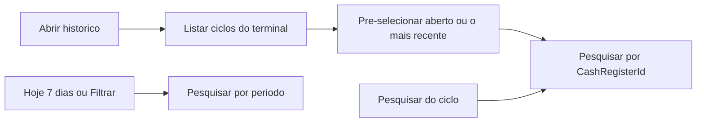

# Busca do histórico por ciclo de caixa

Ao abrir o Histórico, a lista deixa de ser “vendas de hoje” e passa a ser as vendas do ciclo pré-selecionado. A busca por datas permanece intacta e só dispara nos botões já existentes.

## Busca no serviço

Em [`src/AcaiPos.Application/Models/Dtos.cs`](src/AcaiPos.Application/Models/Dtos.cs), `SaleHistoryFilter` ganha `Guid? CashRegisterId`.

Em [`SearchHistoryAsync`](src/AcaiPos.Application/Services/Services.cs), quando `CashRegisterId` vier preenchido, a consulta filtra `Sale.CashRegisterId`. A busca por ciclo não envia datas, operador, status, pagamento nem ticket, então um ciclo que atravessa a meia-noite entra inteiro. A busca por período continua sem esse id e sem mudança de comportamento. O limite de 500 vendas e o filtro do terminal da sessão permanecem.

## Tela

[`SalesHistoryViewModel`](src/AcaiPos.Desktop/ViewModels/SalesHistoryViewModel.cs) recebe `CashRegisterService`. [`MainViewModel`](src/AcaiPos.Desktop/ViewModels/MainViewModel.cs) já tem esse serviço e passa na construção do histórico.

- `Sessions` vem de `ListSessionsAsync` (ciclos do terminal, mais recente primeiro), o mesmo dado do Movimento de Caixa.
- `SelectedSession` só guarda a escolha. Trocar o item não consulta.
- Pré-seleção: ciclo com `IsOpen`, ou o primeiro da lista.
- `SearchByCycleCommand` consulta só esse ciclo e atualiza a grade, os totais e a mensagem.
- `InitializeAsync` carrega os ciclos, pré-seleciona e já executa essa busca. Se não houver ciclo, a lista fica vazia com a mensagem de que não há ciclo neste terminal.
- `TodayCommand`, `Last7DaysCommand` e `SearchCommand` continuam na busca por período.
- O cancelamento recarrega a última busca usada (ciclo ou período).

Em [`MainWindow.xaml`](src/AcaiPos.Desktop/MainWindow.xaml), uma faixa separada, abaixo dos filtros de data: rótulo “Ciclo de caixa”, `ComboBox` com `SessionPickerComboBox` e o mesmo template de período/status/operador do Movimento de Caixa, e o botão **Pesquisar**. O overlay de cancelamento passa a cobrir a linha nova.
