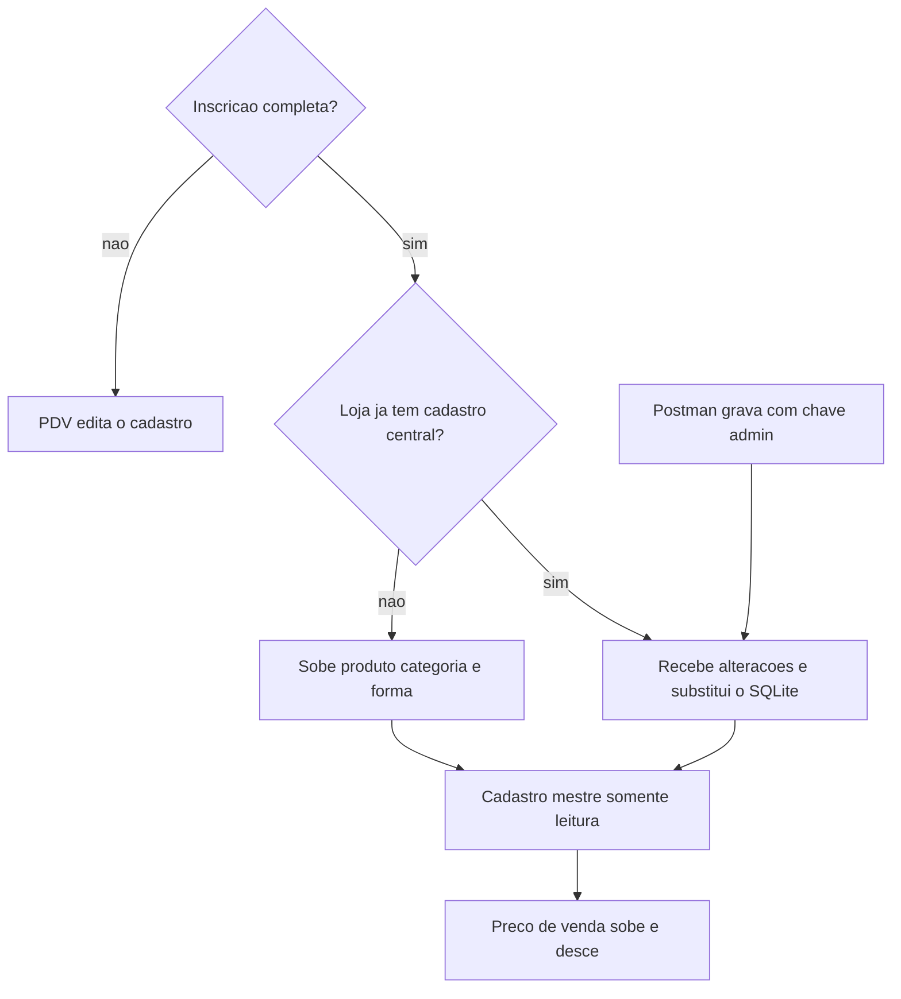

# Descida do catálogo

Não resta decisão de produto. O que segue é o corte desta implementação.

## Decisões já fechadas

- Sem inscrição, o PDV continua editando produto, categoria, forma, usuário, caixa e venda no SQLite.
- Com inscrição completa, produto, categoria e forma de pagamento ficam somente leitura. O preço de venda (`SalePrice`) continua editável.
- Usuário e vendedor ficam para depois. Cliente, quando existir, nasce no terminal. Esta implementação não cria essas entidades nem trava a tela de usuário.
- A primeira inscrição da loja sobe o cadastro local, com os Guids que produto e categoria já têm. A forma de pagamento ganha Guid nessa migração. A inscrição seguinte não reenvia o SQLite por cima: recebe o pacote da loja e substitui o cadastro local quando não houver venda aberta.
- O PDV não chama `POST /api/inscricoes`.
- O Postman grava e altera o cadastro mestre com `X-Chave-Admin`, no mesmo critério de [InscricoesController.cs](src/AcaiPos.Api/Controllers/InscricoesController.cs). O terminal só lê esse cadastro com o token que já usa em `/api/lotes`. SQL manual grava a mesma forma de linha.
- A descida usa `UpdatedAt` e inclui `DeletedAt`. A primeira leitura traz a loja inteira.
- A subida de preço leva só o `Id` do produto, `SalePrice` e `UpdatedAt`. Ela não reenvia nome, SKU, custo nem categoria. A última gravação vence. O estoque local não é substituído pelo número que estiver no MySQL. Ajuste de estoque continua no fluxo que já sobe.
- Venda concluída permanece com nome, SKU e preço gravados no item.
- Estoque central, reserva entre lojas, `Empresa` e `AcaiPos.Management` ficam fora.

## Implementação

A API ganha tabelas e upsert de produto, categoria, vínculo `ProductCategory` e forma de pagamento, sempre com `StoreId` da loja. O ciclo em [SincronizadorFila.cs](src/AcaiPos.Infrastructure/Sync/SincronizadorFila.cs) passa a semear ou receber esse pacote a cada 30 segundos, sem a tela de venda esperar. A troca local espera não haver venda aberta.

No SQLite, `FormaPagamento.Id` e `Payment.FormaPagamentoId` passam de `int` para `Guid` por um `Migrate*` em [DependencyInjection.cs](src/AcaiPos.Infrastructure/DependencyInjection.cs). O pagamento guarda `Descricao`, então a venda antiga continua legível.

As telas de produto, categoria e forma, com inscrição completa, deixam de gravar cadastro mestre. O campo de preço de venda segue gravando e entra na fila só com esse campo.
