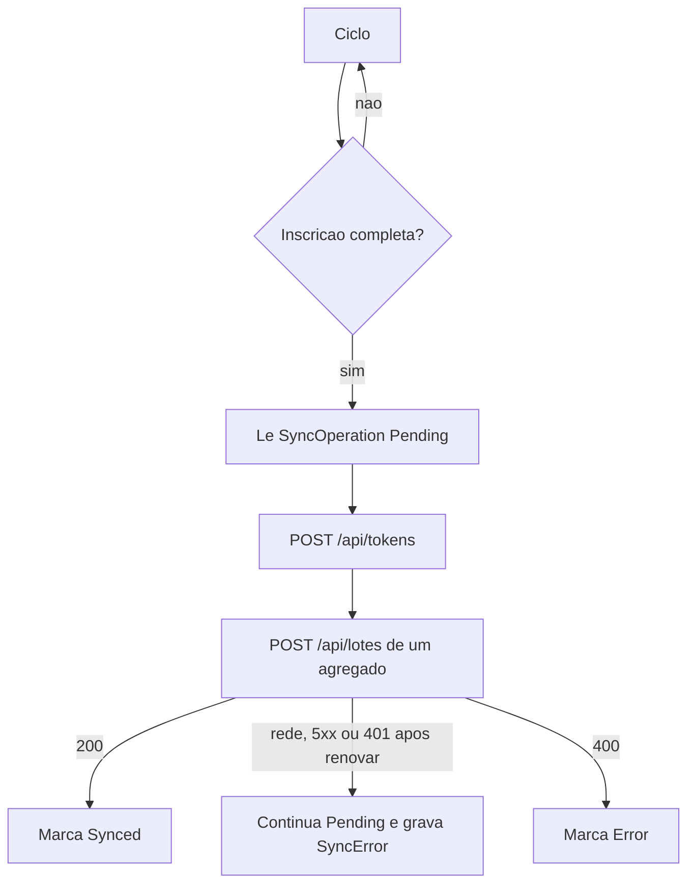

# Fase 3 — Cliente de sincronização no PDV

A API e o MySQL da Fase 2 permanecem. Esta fase só ensina o PDV a esvaziar a fila que já existe. Sem endereço da API e sem segredo, nenhuma tela chama a rede. Login, caixa, catálogo, venda, estoque, ticket e fechamento continuam terminando no SQLite.

O indicador ONLINE / OFFLINE / SINCRONIZANDO / ERRO fica de fora. É o §38.

## O id da inscrição não é o id do SQLite

A inscrição feita no Postman devolveu `lojaId`, `terminalId` e `segredo` criados na API. A venda local carrega o `StoreId` e o `TerminalId` do SQLite. O `POST /api/lotes` recusa o corpo quando esses campos não são os do token (`Lote de outra loja` em [LoteService.cs](src/AcaiPos.Api/Services/LoteService.cs)).

O `Id` da venda, do caixa e dos movimentos continua o do SQLite: é a chave de idempotência. Na hora de montar o JSON, só `StoreId` e `TerminalId` do payload são trocados pelos ids gravados na inscrição. O banco local não é reescrito.

## Tela de inscrição

Nova seção na tela de configurações já aberta em [MainWindow.xaml](src/AcaiPos.Desktop/MainWindow.xaml), ao lado de Interface humana. Os quatro campos são preenchidos à mão com o que a resposta de `POST /api/inscricoes` já mostrou: endereço da API, `lojaId`, `terminalId` e `segredo`. O PDV não chama a inscrição e não recebe o segredo sozinho. Quem fez a inscrição no Postman copia o `segredo` dessa resposta antes de fechá-la. A tela grava esse valor no SQLite, protegido com o DPAPI já usado em [DpapiProtecaoCertificado.cs](src/AcaiPos.Desktop/Fiscal/DpapiProtecaoCertificado.cs), e não o mostra de novo em claro.

A inscrição local é uma linha nova, fora de `SyncOperation`. Não entra no lote. `Configuracao` não serve: ela é auditável e `MarkUpdated` a marcaria como pendente. A coluna nova entra por um `Migrate*` em [DependencyInjection.cs](src/AcaiPos.Infrastructure/DependencyInjection.cs), no mesmo estilo do schema local. SQLite antigo de teste precisa ser recriado se não tiver a tabela; não há backfill.

Salvar a tela não reinicia o PDV. O ciclo seguinte passa a enxergar a inscrição.

## Ciclo

Um `BackgroundService` no host que [App.xaml.cs](src/AcaiPos.Desktop/App.xaml.cs) já sobe. Intervalo de 30 segundos. A tela de venda não espera esse ciclo.

Cada `SyncOperation` pendente vai em um POST próprio. A API recusa o lote inteiro quando um item é inválido; um POST por agregado impede que uma venda ruim segure o caixa.

- 200: a operação e o agregado ficam `Synced`.
- Rede, timeout ou 5xx: continua `Pending`, soma tentativa e grava `SyncError`.
- 401: renova o token uma vez. Se repetir, conta como falha de tentativa.
- 400: `Error`, sem reenviar o mesmo corpo. Uma alteração nova do agregado chama `MarkPending` de novo.

O limite é 5 tentativas. Esgotado, a operação fica `Error` até a próxima alteração local. `MarkPending` em [SyncOperation.cs](src/AcaiPos.Domain/Entities/SyncOperation.cs) hoje não zera `AttemptCount` nem oferece `Synced` / falha. Ganha esses métodos, e a nova alteração zera o contador.

O PDV não referencia o projeto `AcaiPos.Api`. O JSON segue o contrato já publicado em [LoteDtos.cs](src/AcaiPos.Api/Dtos/LoteDtos.cs): venda com itens e pagamentos, caixa, movimento de caixa e movimento de estoque. Venda aberta não está na fila e não é enviada. Catálogo, PIN, NFC-e e o segredo não entram no corpo.

## Prova

Testes de domínio: cinco falhas deixam `Error`; uma alteração seguinte volta a `Pending` com contador zero; 400 não incrementa para novo envio cego. Um teste do montador do lote mostra o `StoreId` e o `TerminalId` da inscrição no JSON e o `Id` da venda igual ao do SQLite. A suíte não precisa do MySQL da SaveInCloud.
