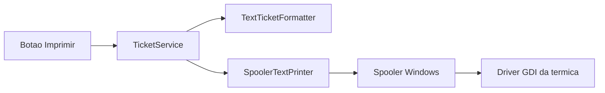

# Impressão térmica via spooler

A primeira entrega cobre só o ticket da venda concluída, e só quando o operador clica em **Imprimir**. A venda continua abrindo o painel de preview em [MainViewModel.CompleteSaleAsync](src/AcaiPos.Desktop/ViewModels/MainViewModel.cs); nada é enviado à impressora nesse momento.

Sangria, suprimento e resumo do ciclo ficam fora desta implementação. O desenho abaixo deixa o envio ao spooler reutilizável para essas fases.

## Como imprime

O aplicativo não fala ESC/POS e não escolhe a impressora. O Windows já tem a térmica (Bematech MP-4200 TH / 2500 TH, Epson TM-T20X, Daruma DR-800 ou equivalente) instalada com o driver do fabricante e definida como **impressora padrão**. O driver traduz o trabalho GDI para a linguagem da impressora. Corte de papel e gaveta permanecem na configuração do driver.

O caminho atual em [WpfTicketPrinter.cs](src/AcaiPos.Desktop/Printing/WpfTicketPrinter.cs) abre `PrintDialog`. Esse diálogo sai. No lugar entra `System.Drawing.Printing.PrintDocument.Print()`, na thread da interface, com `StandardPrintController` para também não mostrar a janela de progresso.

Regras do envio:

- Impressora: a padrão do Windows (`PrinterSettings` já nasce apontando para ela). Sem nome fixo de modelo no código.
- Sem diálogo de seleção e sem diálogo de progresso.
- Largura: a do formulário configurado no driver (bobina 80 mm). O texto continua em 42 colunas, como [TextTicketFormatter.cs](src/AcaiPos.Application/Tickets/TextTicketFormatter.cs).
- Fonte: Courier New. O tamanho começa em 9 pt e desce até a linha de 42 caracteres caber na área útil, medida com o `Graphics` da impressora.
- Altura: calculada pelo número de linhas, para a bobina não avançar uma página A4 em branco.
- Se não houver impressora padrão válida, a mensagem de status é "Nenhuma impressora padrão configurada no Windows." A venda já gravada não é desfeita. O fluxo de erro de [PrintCurrentTicketAsync](src/AcaiPos.Desktop/ViewModels/MainViewModel.cs) permanece.
- Se a padrão for "Microsoft Print to PDF" ou similar, o próprio driver pode pedir arquivo. Isso é configuração do Windows, não do PDV.

O projeto desktop ganha a referência `System.Drawing.Common` (Windows). A camada Application continua sem dependência de impressão gráfica.

## Fase 1 — ticket no botão Imprimir

Substituir [WpfTicketPrinter](src/AcaiPos.Desktop/Printing/WpfTicketPrinter.cs) por um impressor de texto no spooler, registrado no lugar de `ITicketPrinter` em [App.xaml.cs](src/AcaiPos.Desktop/App.xaml.cs).

O contrato [ITicketPrinter](src/AcaiPos.Application/Abstractions/Contracts.cs) e o [TicketService.PrintAsync](src/AcaiPos.Application/Services/TicketService.cs) permanecem. O formatador de 42 colunas também permanece; os testes em [TicketFormatterTests.cs](tests/AcaiPos.Domain.Tests/TicketFormatterTests.cs) seguem válidos.

O botão **Imprimir** do painel do ticket é o único disparo novo de comportamento. A reimpressão que já existe (histórico e lista de tickets de hoje) usa o mesmo `ITicketPrinter`, então também deixa de abrir diálogo e vai para a impressora padrão. Nenhum botão novo.

Auditoria `TICKET_PRINT` / `TICKET_REPRINT` continua depois do envio bem-sucedido.

## Fases seguintes (não implementar agora)

O impressor da fase 1 recebe nome do trabalho e texto puro. As próximas fases só acrescentam formatador, dados e botão.

- **Sangria e suprimento.** Comprovante ao confirmar a movimentação, nos dois pontos que já gravam: painel do [MainViewModel](src/AcaiPos.Desktop/ViewModels/MainViewModel.cs) e ciclo em [CashSessionViewModel](src/AcaiPos.Desktop/ViewModels/CashSessionViewModel.cs). `AddMovementAsync` passa a devolver o movimento criado. Texto: loja, terminal, tipo, data, operador, valor, motivo e linha de assinatura. Reimpressão pela linha do ciclo.
- **Resumo do caixa.** Botão no ciclo selecionado da tela "Movimento do caixa". Conteúdo a partir de `CashSessionDetailDto`: abertura, operador, fundo, vendas por forma de pagamento, sangrias, suprimentos, saldo da gaveta e saldo geral. Ciclo fechado inclui contado, esperado e diferença, lidos de `CashRegister`.
- **NFCe.** Fora deste desenho. O mesmo spooler pode receber o DANFE depois; QR Code e layout fiscal não entram agora.

Falha de impressão nunca desfaz venda, sangria ou fechamento já gravados.
