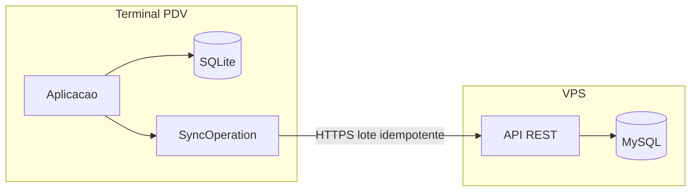

# Plano — Offline-first até segurança

| Campo | Valor |
| --- | --- |
| Id | `arquitetura.offline-sync` |
| Status | Roteiro. Este documento não cria projeto, tabela, endpoint nem cliente HTTP. |
| Spec | `POS_FUNCTIONAL_SPEC.md` §21–§29, com a ordem de §39 |
| Núcleo atual | SQLite em `PosDbContext`, `Entity` / `AuditableEntity`, `Store`, `Terminal`, `Sale` |
| Próxima fase da spec | §39 fase 2: API, autenticação central, banco remoto e sincronização básica |

O PDV da primeira versão já vende, recebe, imprime e fecha o caixa no banco local. Este plano cobre o trecho da spec que prepara esse terminal para uma API central, sem tirar a venda do SQLite e sem abrir ainda a rede de lojas, o delivery nem a nuvem Azure.

A ordem é a da §39. O MVP local está encerrado. A fase seguinte é API, banco central, sync básico e autenticação dessa API. Vários PDVs entram aqui só como campos e contrato. Empresa, conflito, estoque central e relatório consolidado continuam na fase 3 da spec.

## Leitura dos tópicos

| Tópico | Estado no código | O que este plano faz |
| --- | --- | --- |
| §21 Offline-first | Cumprido | Mantém a venda no SQLite. A rede só esvazia a fila. |
| §22 Preparação para sync | Quase cumprido nas entidades auditáveis | Grava `StoreId` na venda e no caixa. Adia o `Guid` de `FormaPagamento` para o catálogo. |
| §23 Exclusão lógica | Método pronto, uso incompleto | Troca a exclusão física da movimentação de caixa por `SoftDelete`. |
| §24 Serviço de sincronização | Por fazer | Fila local `SyncOperation` / `SyncError`, depois API e um ciclo em background. |
| §25 Idempotência | Por fazer | O `Id` do agregado é a chave. Reenviar a mesma venda não cria outra. |
| §26 Múltiplos PDVs | Loja e terminal já existem | O contrato carrega loja, terminal, operador e origem. A rede de lojas fica para a fase 3. |
| §27 Banco remoto | Por fazer | MySQL no banco já criado na VPS da SaveInCloud, espelho do que o primeiro lote sobe. |
| §28 API REST | Por fazer | `AcaiPos.Api` na mesma solution. A API não exige o PDV online para a venda existir. |
| §29 Segurança | PIN e certificado já protegidos no terminal | HTTPS, token do terminal, validação, log e limite de taxa na API. |

## O que o código já cumpre

A venda grava no SQLite. `InitializeDatabaseAsync` chama `EnsureCreated` e, em seguida, migrações manuais em `src/AcaiPos.Infrastructure/DependencyInjection.cs`. Não há pasta `Migrations` do EF e não há cliente HTTP no fluxo de venda. O caixa abre e a venda conclui com a sessão e o banco locais.

`Entity` usa `Guid`. `AuditableEntity` já traz `CreatedAt`, `UpdatedAt`, `DeletedAt` e `SyncStatus` (`Pending`, `Synced`, `Error`). Herdam isso: loja, terminal, produto, categoria, usuário, caixa, movimentação de caixa, venda, estoque, configuração, configuração fiscal e documento fiscal. `SoftDelete()` preenche `DeletedAt` e devolve o registro a `Pending`. As consultas filtram `DeletedAt == null` na aplicação. Não há filtro global do EF.

O seed cria `LOJA-01` e `PDV-01`. `Terminal` guarda `StoreId`. `Sale` já guarda `TerminalId`, `OperatorId` e `SaleOrigin`. `CashRegister` e `CashMovement` guardam terminal e operador.

No terminal, o PIN vai para o banco como PBKDF2 (`Pbkdf2PasswordHasher`: sal, 100.000 iterações, SHA-256). A senha do certificado fiscal passa por DPAPI (`DpapiProtecaoCertificado`). Esse par é o modelo da credencial que a API vai usar: segredo no terminal protegido pelo Windows, nunca no código-fonte.

O schema local continua nesse estilo. Coluna nova e tabela nova entram como mais um método `Migrate*` chamado depois de `EnsureCreated`, no mesmo lugar das migrações de categoria, acréscimo, forma de pagamento, fiscal e configuração. Esta fase não introduz migrations do EF.

## Lacunas que as fases fecham

`SaleItem`, `Payment` e `ProductCategory` não são auditáveis. Item e pagamento sobem dentro da `Sale`. Eles não ganham `SyncStatus` próprio. `ProductCategory` continua vínculo e, quando o catálogo sincronizar, viaja com o produto.

`FormaPagamento` ainda usa `int` autoincremento, e `Payment.FormaPagamentoId` aponta para esse inteiro. Isso foge da preferência por GUID da §22. O primeiro lote de vendas não espera essa migração: o pagamento já guarda a descrição praticada (`Payment.Descricao`). A central persiste o inteiro e o texto. A troca para `Guid` acontece quando produtos, categorias, usuários e formas passarem a descer da central. Vendas já enviadas permanecem legíveis pelo snapshot da descrição.

`CashRegisterService.RemoveMovementAsync` ainda chama `_db.Remove` em `src/AcaiPos.Application/Services/Services.cs`. A linha some e uma exclusão já enviada não teria o que propagar. A movimentação de caixa passa a `SoftDelete`. A linha fica, `DeletedAt` é preenchido e a fila ganha uma operação de exclusão. Remover item de venda ainda aberta pode continuar físico: venda aberta não entra no primeiro lote. Venda concluída ou cancelada não é apagada; o cancelamento já é estado (`SaleStatus.Cancelled`), com motivo, operador e data.

`Sale` e `CashRegister` não guardam `StoreId`. O terminal tem a loja, e a §26 pede a loja na venda. Na criação, os dois agregados copiam `StoreId` do terminal da sessão. O valor fica no registro novo para o lote identificar a loja sem join. Vendas e caixas já gravados no SQLite são de teste e não recebem correção. Um terminal não muda de loja: `Terminal.StoreId` vale para a vida inteira do terminal, e o domínio não ganha operação de remanejamento. A cópia na venda e no caixa repete esse vínculo fixo. Ela não existe para sobreviver a uma troca de loja.

Não existe `Empresa`. A §42 não lista empresa no modelo inicial, e a §26 reserva esse nível para vários CNPJs. A fronteira do primeiro contrato é a loja. `Empresa` espera a fase 3.

`SyncStatus` existe e volta a `Pending` em `MarkUpdated`, mas ninguém marca `Synced` nem varre pendências. A fila de verdade é `SyncOperation` e `SyncError`, os nomes já previstos na §42. `SyncStatus` no agregado continua como espelho: `Pending` ao enfileirar, `Synced` quando a API confirma, `Error` quando a tentativa esgota o ciclo atual. A chave de idempotência da venda é `Sale.Id`. O mesmo GUID reenviado atualiza a mesma linha central.

`ConfiguracaoFiscal` guarda CSC, arquivo e senha do certificado. Nada disso entra no payload. O XML e o protocolo da NFC-e também ficam no terminal neste corte. O documento fiscal é módulo à parte (§31) e não bloqueia a subida da venda.

`AcaiPos.Management` permanece casca com catálogo de exemplo. Não é cliente desta API nesta fase.

## Decisões

A API nasce como `src/AcaiPos.Api`, ASP.NET Core, na mesma solution, reusando Domain e Application. O banco central é MySQL, no banco já criado na VPS da SaveInCloud. O provider é `MySql.EntityFrameworkCore` 10.0.12, o Connector/NET que acompanha o EF Core 10 desta API. `Central:Provider` vale `MySql` e a subida chama `UseMySQL`. O Pomelo oficial publica até o EF Core 9 e não entra neste projeto. Azure não entra nesta fase: a §41 pede tecnologia quando houver um problema que esta API e este banco não resolvam.

O catálogo MySQL já existe na SaveInCloud. Na subida, `EnsureCreated` cria as tabelas quando o catálogo existe e ainda não tem nenhuma. A connection string, a chave de assinatura e a chave admin ficam no `appsettings.json` da API. Os testes da API seguem em SQLite (`Central:Provider=Sqlite`). O domínio, o contrato do lote e o SQLite do terminal não mudam. Se o catálogo da SaveInCloud já tiver tabela de outro uso, a API usa um catálogo vazio só dela.

Um terminal pertence à loja em que foi criado durante toda a vida. `Terminal.StoreId` é imutável. Não há remanejamento de terminal entre lojas. Venda e caixa copiam esse `StoreId` na criação para carregar a loja no próprio registro.

A venda concluída no terminal nunca espera a API. A mesma transação que grava a venda, o cancelamento, o caixa ou o estoque grava a `SyncOperation`. Falha de rede, timeout ou HTTP 5xx deixam a operação pendente. O operador segue na tela de venda.

Um PDV autônomo funciona sem API. Login, caixa, catálogo, venda, estoque, ticket e fechamento nascem e terminam no SQLite. A chamada à API é opcional e só existe quando o terminal está inscrito: sem endereço da API e sem segredo, o ciclo de envio não começa e a fila permanece local. Cliente com um único caixa não precisa de VPS, inscrição nem token.

O primeiro fluxo é só subida. Descidas de catálogo, usuário e forma de pagamento esperam a fase de vários terminais. Até lá esses cadastros continuam nascendo no PDV.

A autenticação da API é do terminal. Na inscrição, a API devolve um segredo; o PDV guarda esse segredo com DPAPI, no mesmo espírito da senha do certificado. O operador continua entrando com PIN local, para o caixa abrir sem internet. O cliente troca o segredo por um token curto e envia o token no header. O corpo leva o `Id` do agregado como chave de idempotência. Repetir o lote é seguro.

HTTPS em produção, validação de entrada, log com terminal e id da operação e limite de taxa no endpoint de autenticação. A connection string e as chaves da API ficam no `appsettings.json`. Certificado fiscal e CSC continuam só no terminal.

## Contrato do primeiro lote

Cada item do lote é um agregado já fechado no terminal, com `StoreId`, `TerminalId` e o `Id` que a central usa para upsert.

| Agregado | Quando enfileira | O que viaja | Chave |
| --- | --- | --- | --- |
| `Sale` | Conclusão e cancelamento | Venda, itens e pagamentos. Origem, operador, loja e terminal. Descrição da forma no pagamento. | `Sale.Id` |
| `CashRegister` | Abertura, fechamento e qualquer alteração já persistida do caixa | Caixa, operador, valores de abertura e fechamento, loja e terminal | `CashRegister.Id` |
| `CashMovement` | Inclusão e exclusão lógica | Tipo, valor, motivo, operador, terminal, `DeletedAt` quando houver | `CashMovement.Id` |
| `StockMovement` | Saída da venda, estorno do cancelamento e ajuste manual | Produto, quantidade, saldos, motivo, venda e operador quando existirem | `StockMovement.Id` |

Venda aberta não entra. Produto, categoria, usuário, forma de pagamento, configuração fiscal, XML de NFC-e e `AuditEntry` não entram neste lote. A auditoria local continua no terminal; enviá-la é decisão posterior.

A central trata o corpo como upsert. Se o `Id` já existe, atualiza a mesma linha e responde sucesso. Duas respostas de sucesso para o mesmo `Id` deixam uma venda, um caixa ou um movimento. A exclusão lógica chega com `DeletedAt` preenchido e a central marca a mesma linha, sem apagá-la.

`SyncOperation` no SQLite guarda o tipo do agregado, o `Id` do agregado, o tipo da operação (inclusão/atualização ou exclusão lógica), o estado (`Pending`, `Synced`, `Error`), a contagem de tentativas, o último erro e as datas. `SyncError` guarda a tentativa que falhou: operação, momento, código HTTP ou falha de rede, e a mensagem. O payload é montado na hora do envio a partir do banco local, para a fila não duplicar a venda.

A resposta do lote confirma cada `Id` aceito. O cliente marca essas operações como `Synced` e o agregado correspondente também. Id rejeitado por validação vai para `Error` com a mensagem, sem novo retry cego do mesmo corpo inválido. Falha de rede e resposta 5xx permanecem `Pending` e entram no ciclo seguinte.

## Fase 1 — Fechar o modelo local, sem rede

Escopo no Domain, na Application, no Infrastructure e nos testes. Nenhum projeto novo.

- `Sale` e `CashRegister` passam a exigir `StoreId` na criação, copiado do terminal da sessão. `Terminal.StoreId` permanece o definido na criação do terminal, sem método que o altere. Não há migração que preencha vendas e caixas anteriores: o SQLite de teste é recriado e o schema novo já nasce com a coluna.
- `RemoveMovementAsync` deixa de apagar a linha. Chama `SoftDelete` na movimentação. O caixa aberto deixa de considerá-la no saldo, e a linha permanece para a fila.
- Nas mesmas transações de conclusão de venda, cancelamento, abertura e fechamento de caixa, movimentação de caixa e movimentação de estoque, gravar `SyncOperation` em `Pending`.
- Criar `SyncError` no modelo, ainda sem gravar erro de rede, porque ainda não há cliente.

Critério desta fase: os testes mostram que concluir ou cancelar a mesma `Sale` deixa uma `SyncOperation` para aquele `Sale.Id`, e que excluir uma movimentação de caixa preserva a linha com `DeletedAt`. A venda de balcão, o ticket e o fechamento seguem iguais para o operador. Esta fase ainda não fala com a rede.

## Fase 2 — API e MySQL mínimos

Novo projeto `src/AcaiPos.Api`. Banco MySQL na SaveInCloud, separado do SQLite do terminal. O provider, o padrão `MySql` e a connection string ficam no `appsettings.json`. A criação das tabelas num catálogo que já existe está no código.

- Inscrição do terminal: a API reconhece loja e terminal e devolve o segredo uma vez.
- Troca do segredo por token curto.
- `POST` do lote com os quatro agregados da tabela acima.
- Persistência central idempotente por `Id`.
- Corpo inválido responde erro de validação e não grava metade do agregado.
- Log com id do terminal e id da operação. Limite de taxa no endpoint de autenticação.
- Connection string, segredo de assinatura do token e demais credenciais só por ambiente.

Critério desta fase: o mesmo lote enviado duas vezes deixa uma linha de cada agregado. Um lote sem token, com loja de outro terminal ou com venda sem item concluído é recusado. A suíte da API cobre esses dois casos. O PDV ainda não chama essa API.

## Fase 3 — Cliente no PDV

Um ciclo em background no Desktop lê `SyncOperation` pendente, monta o lote, envia e marca `Synced` ou `Error`. Ele só sobe se o terminal tiver endereço da API e segredo de inscrição. Sem essa configuração, o ciclo não existe e nenhuma tela chama a API. Timeout e falha de rede devolvem a operação para `Pending` e registram `SyncError`. O ciclo tem intervalo e limite de tentativas por operação; esgotado o limite, a operação fica `Error` até uma nova alteração do agregado recolocar `Pending`.

A tela de venda não espera esse ciclo. Concluir a venda retorna quando o SQLite confirma, com a fila já gravada na mesma transação. Ausência da API não bloqueia abertura do caixa, venda, ticket nem fechamento.

O indicador ONLINE / OFFLINE / SINCRONIZANDO / ERRO é o §38. Fica citado como passo seguinte e não ganha tela neste plano. Até lá, o estado mora em `SyncOperation` e `SyncError`.

Critério desta fase: com a API no ar, uma venda concluída offline aparece na central depois que a rede volta, uma única vez. Com a API fora, a mesma venda permanece no caixa e na fila.

## Fase 4 — Preparar vários PDVs, sem construir a rede de lojas

O contrato da fase 2 já carrega loja, terminal, operador e origem. Esta fase não cadastra a segunda loja nem resolve conflito. Ela só deixa escrito o que a fase 3 da spec (§39) vai descer e o que continua adiado, para o primeiro lote não fechar a porta.

Quando houver mais de um terminal na mesma loja, a central passa a ser a origem destes cadastros, e o PDV passa a recebê-los:

- produtos e o vínculo `ProductCategory`;
- categorias;
- usuários, com o hash do PIN, nunca o PIN em claro;
- formas de pagamento, já então com `Guid` no lugar do `int`.

Continuam adiados, junto com a fase 3 da spec:

- entidade `Empresa` e mais de um CNPJ;
- política de conflito quando o mesmo produto muda em dois terminais;
- estoque central e reserva entre lojas;
- relatórios consolidados.

Até essa fase, cada terminal segue dono do próprio catálogo e dos próprios usuários. Duas lojas ainda não compartilham cadastro.

## Segurança no terminal e na API

| Requisito da §29 | Onde vale neste corte |
| --- | --- |
| HTTPS | A API de produção só aceita HTTPS. O cliente do PDV recusa endpoint sem TLS fora do desenvolvimento local. |
| Autenticação | Token do terminal, obtido com o segredo de inscrição. O PIN do operador permanece local. |
| Autorização | O token só envia lote da loja e do terminal inscritos. Um terminal não grava venda de outro. |
| Tokens seguros | Vida curta, assinados com segredo de ambiente. O segredo de inscrição fica sob DPAPI no PDV. |
| Proteção de endpoints | Lote e inscrição exigem credencial. Superfície pública limitada à troca do segredo por token. |
| Validação de entrada | Agregado incompleto, id vazio, loja divergente do token e status de venda ainda aberta são recusados. |
| Logs | Cada tentativa registra terminal, id da operação e resultado. O corpo do CSC, a senha do certificado e o PIN não entram no log. |
| Limite de taxa | No endpoint que troca segredo por token. |
| Proteção de credenciais | Connection string e chaves da API no `appsettings.json`. Certificado e CSC continuam só no SQLite do terminal, a senha do certificado sob DPAPI. |
| Senha sem texto puro | PIN já é PBKDF2. A API não recebe PIN do operador neste corte. |
| Segredo fora do código | CSC, senha do certificado e segredo de terminal inscrito ficam fora do repositório. A connection string da API está no `appsettings.json`. |

## Fora deste plano

Ficam para os tópicos seguintes, ou para a fase 3 da §39 quando o texto acima não os puxou:

- §30 em diante, inclusive iFood e os adaptadores descritos em `docs/integracoes/delivery-visao-geral.md`;
- emissão, cancelamento e XML de NFC-e na API;
- indicador de conectividade na tela (§38);
- Application Insights, mensageria e qualquer recurso Azure;
- transformar `AcaiPos.Management` em cliente administrativo.

O critério para começar a fase 1 é este documento. Cada fase só começa com o critério da anterior atendido. A venda local permanece o caminho que o operador já usa hoje.
