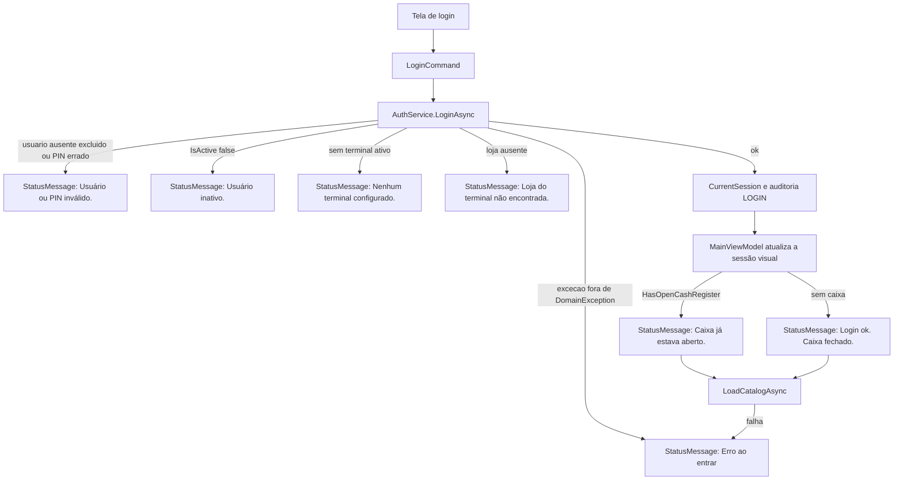

# Fluxo 01 — Login

| Campo | Valor |
| --- | --- |
| Id | `operacional.login` |
| Nome | Entrar no PDV |
| Tipo | Operacional |
| Ator | Qualquer `User` ativo e não excluído (`UserRole.Operator`, `Manager` ou `Administrator`) |
| Tela | Grade de login em `MainWindow` (`LoginVisibility`) |
| Pré-condição | Aplicativo aberto e `MainViewModel.IsAuthenticated == false`. A grade de login aparece mesmo sem usuário ou terminal no banco; a ausência deles é desvio, não trava a tela. O banco local é `%LocalAppData%\AcaiPos\acai-pos.db`. |
| Resultado de sucesso | `CurrentSession` autenticada, auditoria `LOGIN` gravada, workspace visível na tela `Sale`, catálogo e formas de pagamento carregados. |

Este documento descreve o PDV em `src/AcaiPos.Desktop`. O login de `src/AcaiPos.Management` não entra aqui: `LoginViewModel.Enter` só exige campos preenchidos e abre a tela principal, sem `AuthService`.

O manual do operador continua em `MANUAL_DE_USO.md`. Aqui o controle é o código: classe, método, propriedade e o que cada desvio deixa para trás.

## O que este fluxo não faz

- Não encerra a sessão. O botão **Sair** chama `LogoutCommand` → `MainViewModel.LogoutAsync` → `AuthService.LogoutAsync`. Isso é outro fluxo.
- Não abre nem fecha o caixa. Se já houver caixa `Open` no terminal escolhido, só reflete isso em `IsCashOpen`. Se não houver, deixa `ShowCashOpenPanel` em `false`: a abertura é opcional e o operador segue para o workspace.
- Não consulta `User.CanApplyDiscount`, `User.CanCancelSales`, `User.CanManageProducts`, `User.CanManageUsers` nem `User.CanOpenCashRegister`. As duas permissões da tela saem só do `UserRole` devolvido em `LoginResultDto.Role`.
- Não escolhe terminal nem loja. Usa o primeiro terminal ativo e não excluído.
- Não zera carrinho, pagamentos, desconto ou painéis. No primeiro arranque essas coleções já nascem vazias. Quem as limpa é o logout.

## Superfície

Arquivo: `src/AcaiPos.Desktop/MainWindow.xaml`. A grade fica visível enquanto `LoginVisibility` é `"Visible"`.

| Controle | Binding | Efeito |
| --- | --- | --- |
| Campo Usuário | `Username`, `UpdateSourceTrigger=PropertyChanged` | Texto livre. Valor inicial `"operador"`. |
| Campo PIN | `Pin`, `UpdateSourceTrigger=PropertyChanged` | `TextBox` visível, não é `PasswordBox`. `MaxLength` 8. |
| Teclas `0`–`9` | `AppendPinCommand`, `CommandParameter` = o dígito | `MainViewModel.AppendPin` |
| Tecla `C` | `ClearPinCommand` | `Pin = ""` |
| Tecla `⌫` | `BackspacePinCommand` | Remove o último caractere se `Pin.Length > 0` |
| Botão **ENTRAR** | `LoginCommand` | `MainViewModel.LoginAsync`. `RelayCommand.CanExecute`: `!_isExecuting && !IsAuthenticated`. Um segundo clique não dispara outro login enquanto o primeiro não termina. Sem `IsDefault`: Enter no teclado físico não dispara o comando. |
| Mensagem | `StatusMessage` | Texto inicial: `Entre com seu usuário e PIN para começar.` |

A coluna esquerda da tela mostra as credenciais de seed (`operador` / `1234`, e também `admin` e `gerente`). Isso é texto fixo do XAML, não uma consulta ao banco.

`AppendPin` ignora parâmetro nulo ou em branco e não passa de 8 caracteres. O serviço não repete esse limite: quem ultrapassar o teto é só a tela.

## Estado inicial relevante

| Propriedade | Valor ao abrir |
| --- | --- |
| `IsAuthenticated` | `false` |
| `LoginVisibility` | `"Visible"` |
| `WorkspaceVisibility` | `"Collapsed"` |
| `Username` | `"operador"` |
| `Pin` | `""` |
| `IsCashOpen` | `false` |
| `CanManageCatalog` / `CanManageUsers` | `false` |
| `CurrentScreen` | `"Sale"` |
| `ConnectionStatus` | `"OFFLINE-LOCAL"` (o login não altera) |
| `CurrentSession.IsAuthenticated` | `false` (`CurrentUser` nulo) |

## Diagrama

## Caminho feliz

1. O operador ajusta `Username` e `Pin` e aciona `LoginCommand`.
2. `MainViewModel.LoginAsync` chama `AuthService.LoginAsync(Username, Pin)`.
3. O serviço normaliza o usuário com `username.Trim().ToLowerInvariant()`. O PIN segue como foi digitado, sem `Trim`.
4. Busca `User` com `Username` igual ao normalizado e `DeletedAt == null`.
5. Exige `User.IsActive`.
6. Confere o PIN com `IPasswordHasher.Verify` (`Pbkdf2PasswordHasher`). O valor guardado é `User.PinHash`, nunca o PIN em claro.
7. Toma o primeiro `Terminal` com `IsActive && DeletedAt == null`. Não há `OrderBy`.
8. Busca `Store` com `Id == Terminal.StoreId`.
9. Busca o primeiro `CashRegister` do terminal com `Status == CashRegisterStatus.Open`. Pode ser nulo.
10. Grava a sessão: `SetUser`, `SetTerminal`, `SetCashRegister`.
11. `AuditService.LogAsync("LOGIN", nameof(user), user.Id, "Usuário {username} autenticado.")` e `SaveChangesAsync`.
12. Devolve `LoginResultDto`.
13. A view model publica o workspace, define papel, operador, terminal e a mensagem de caixa, e chama `LoadCatalogAsync`.

`LoginResultDto`: `UserId`, `Name`, `Username`, `Role`, `TerminalId`, `TerminalCode`, `StoreId`, `StoreName`, `HasOpenCashRegister`.

A view model usa `Name`, `Role`, `StoreName`, `TerminalCode` e `HasOpenCashRegister`. `UserId`, `Username`, `TerminalId` e `StoreId` ficam nas entidades da `CurrentSession`, não são copiados para propriedades da tela.

## Desvios antes de autenticar

Todos estes saem de `AuthService.LoginAsync` como `DomainException`. `LoginAsync` da view model copia `ex.Message` para `StatusMessage`. `IsAuthenticated` permanece `false`, a grade de login continua visível, `Pin` e `Username` permanecem como o operador deixou, e `CurrentSession` não é alterada.

A ordem dos testes importa. Usuário inativo com PIN errado recebe `Usuário inativo.`, porque `IsActive` é testado antes do hash.

| Condição | Mensagem | Sessão |
| --- | --- | --- |
| `Username` vazio, só espaços, inexistente, ou `DeletedAt != null` | `Usuário ou PIN inválido.` | intacta |
| `User.IsActive == false` | `Usuário inativo.` | intacta |
| `Pbkdf2PasswordHasher.Verify` devolve `false` (PIN errado, PIN vazio, ou `PinHash` fora do formato `pbkdf2$...`) | `Usuário ou PIN inválido.` | intacta |
| Nenhum terminal com `IsActive && DeletedAt == null` | `Nenhum terminal configurado.` | intacta |
| `Store` do `Terminal.StoreId` não existe | `Loja do terminal não encontrada.` | intacta |

A mensagem de credencial inválida não distingue usuário ausente, usuário excluído e PIN errado.

Qualquer outra exceção (falha de banco, por exemplo) cai no `catch (Exception)` da view model: `StatusMessage = "Erro ao entrar: {ex.Message}"`. Ver também os dois desvios de estado mais abaixo: eles acontecem depois que a sessão em memória, ou a tela, já mudou.

## Sessão e auditoria no sucesso

`CurrentSession` (`ICurrentSession`), nesta ordem:

| Método | Efeito |
| --- | --- |
| `SetUser(user)` | `CurrentUser`. `IsAuthenticated` passa a `true` porque `CurrentUser` não é nulo. |
| `SetTerminal(terminal, store)` | `CurrentTerminal` e `CurrentStore`. |
| `SetCashRegister(openCash)` | `OpenCashRegister` é o caixa `Open` ou `null`. `HasOpenCashRegister` é `true` só quando o objeto existe e `Status == Open`. |

`AuditEntry` persistido no mesmo `SaveChangesAsync`:

| Campo | Valor |
| --- | --- |
| `Action` | `"LOGIN"` |
| `EntityName` | `"user"` — é `nameof(user)`, o nome da variável local, não `"User"` |
| `EntityId` | `User.Id` |
| `OperatorId` | `CurrentUser.Id` (já definido por `SetUser`) |
| `TerminalId` | `CurrentTerminal.Id` (já definido por `SetTerminal`) |
| `Details` | `Usuário {username} autenticado.` |
| `OccurredAt` | `DateTime.UtcNow` |

Se houver mais de um caixa `Open` no mesmo terminal, entra o primeiro que o EF devolver. O fluxo não trata isso como erro.

## O que a view model publica

Método: `MainViewModel.LoginAsync`, depois do retorno do serviço.

| Propriedade | Valor |
| --- | --- |
| `IsAuthenticated` | `true`. Dispara `LoginVisibility = "Collapsed"` e `WorkspaceVisibility = "Visible"`. Reavalia `LoginCommand`, `LogoutCommand`, comandos de caixa, navegação, reimpressão e menu de caixa. |
| `IsCashOpen` | `LoginResultDto.HasOpenCashRegister` |
| `CanManageCatalog` | `true` se `Role` é `Manager` ou `Administrator` |
| `CanManageUsers` | `true` só se `Role` é `Administrator` |
| `CatalogButtonVisibility` | `"Visible"` quando `CanManageCatalog` |
| `UsersButtonVisibility` | `"Visible"` quando `CanManageUsers` |
| `AdminSectionVisibility` | `"Visible"` quando qualquer um dos dois é `true` |
| `OperatorName` | `LoginResultDto.Name` |
| `TerminalLabel` | `"{StoreName} · {TerminalCode}"` |
| `Pin` | `""` |
| `Username` | permanece |
| `CurrentScreen` | `"Sale"` (o setter também zera `ShowCashMenu`) |
| `ShowCashOpenPanel` | `false` nos dois casos. O painel só abre depois, pelo item **Abrir caixa** da barra lateral (`OpenCashCommand`). |
| `StatusMessage` | Caixa aberto: `Caixa já estava aberto. Pronto para vender.` Caixa fechado: `Login ok. Caixa fechado. A abertura é opcional; vendas exigem caixa aberto.` |

Papel e o que a navegação passa a permitir (`CanExecute` exige `IsAuthenticated`; catálogo e usuários exigem também a flag):

| `UserRole` | Venda, Histórico, Caixa | Catálogo | Usuários |
| --- | --- | --- | --- |
| `Operator` (0) | sim | não | não |
| `Manager` (1) | sim | sim | não |
| `Administrator` (2) | sim | sim | sim |

Seed, só quando a tabela de usuários ainda está vazia (`Infrastructure/DependencyInjection.cs`, `SeedAsync`): `admin`, `gerente` e `operador`, todos com PIN `1234`, mais a loja `LOJA-01` / `Açaí Prime Centro` e o terminal `PDV-01`.

## Catálogo carregado em seguida

`MainViewModel.LoadCatalogAsync`:

1. `Categories.Clear()` e inclusão de `CategoryDto(Guid.Empty, "Todos", null, 0)`.
2. `CatalogService.GetActiveCategoriesAsync`: categorias com `IsActive && DeletedAt == null`, ordenadas por `SortOrder` e `Name`.
3. `_selectedCategoryId = null`.
4. `LoadProductsAsync` → `CatalogService.GetSellableProductsAsync(null, SearchText)`. `SearchText` ainda é o valor inicial `""`, então lista produtos com `IsActive && DeletedAt == null`.
5. `LoadPaymentMethodsAsync` → `SaleService.ListPaymentMethodsAsync(enabledOnly: true)`: `FormaPagamento` com `IsEnable`, ordenadas por `Ordem` e `Descricao`, copiadas para `PaymentMethods`.

## Desvios de estado

**`SaveChangesAsync` falha depois de `SetUser`.** A `CurrentSession` já está autenticada e o `AuditEntry` pode estar só na memória do contexto. A exceção sobe para o `catch` genérico da view model, que ainda não executou `IsAuthenticated = true`. A tela continua no login, `LoginCommand` segue habilitado e `StatusMessage` fica `Erro ao entrar: ...`. Serviços que leem `ICurrentSession.IsAuthenticated` enxergam um operador logado enquanto a grade de login ainda está na frente.

**`LoadCatalogAsync` falha.** Nesse ponto `IsAuthenticated` já é `true`, o PIN já foi limpo, `CurrentScreen` já é `"Sale"` e `ShowCashOpenPanel` permanece `false`. O workspace aparece e `StatusMessage` vira `Erro ao entrar: ...`. `Categories` pode ter ficado pela metade: o método limpa a coleção e adiciona `"Todos"` antes de consultar o banco.
