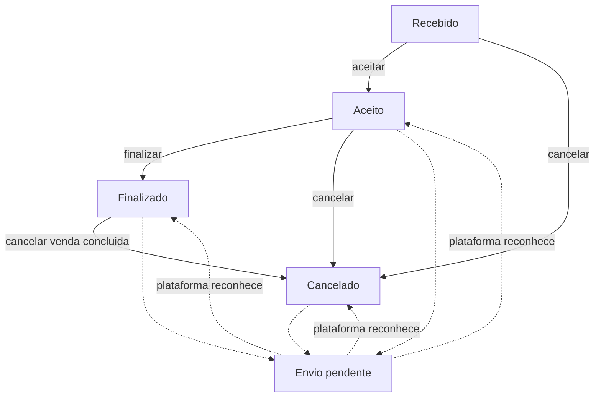
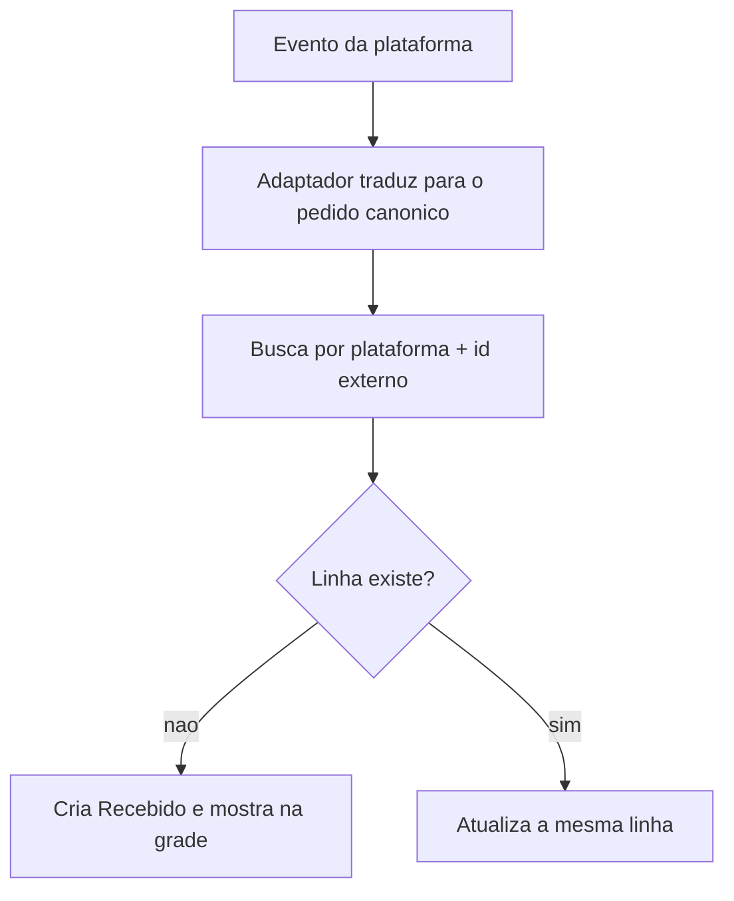
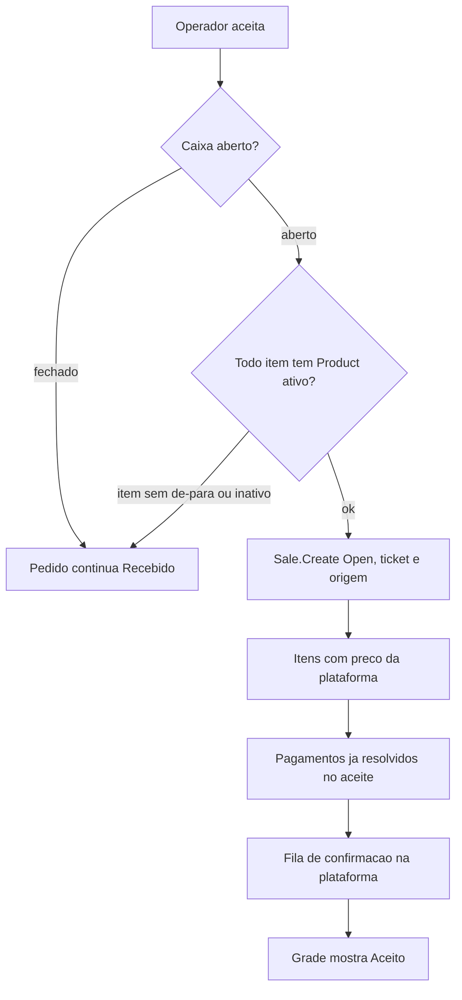
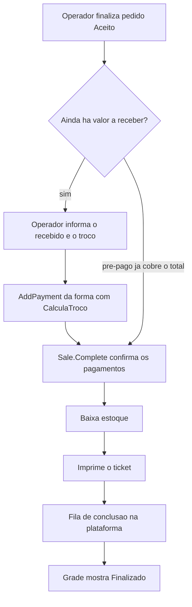
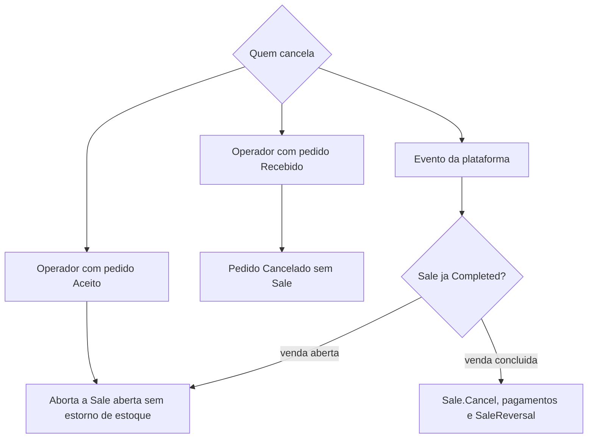
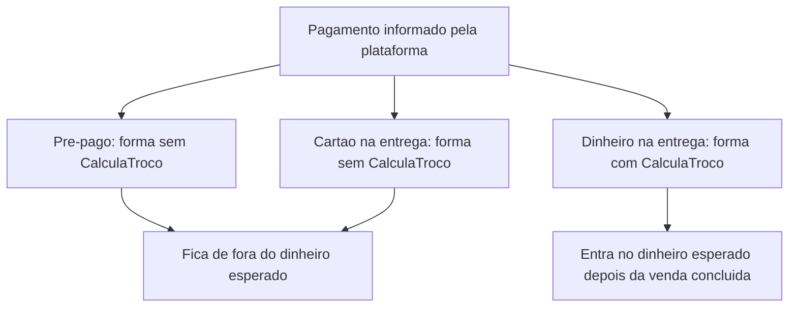
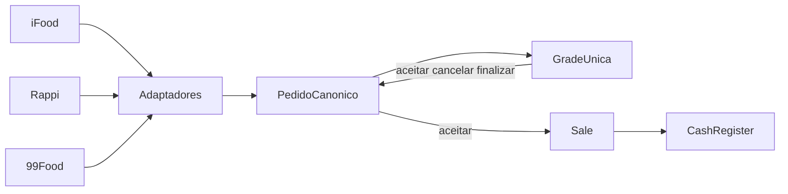

# Visão geral — Integração de delivery

| Campo | Valor |
| --- | --- |
| Id | `integracao.delivery` |
| Status | Visão de arquitetura. Este documento não implementa adaptador, tabela nem tela. |
| Plataformas | iFood, Rappi, 99Food e outras que entrarem pelo mesmo contrato |
| Núcleo atual | `Sale`, `Payment`, `CashRegister` e `SaleService` em `src/AcaiPos.Domain` e `src/AcaiPos.Application` |
| Spec | `POS_FUNCTIONAL_SPEC.md` §3.6, §14, §16, §29, §30–§32 |

O operador vê uma grade só. Cada linha é um pedido, venha do iFood, da Rappi, do 99Food ou de uma plataforma futura. As ações da grade são as mesmas: aceitar, cancelar e finalizar. Aceitar abre uma venda do PDV. Finalizar conclui essa venda, baixa estoque e imprime o ticket. O pagamento que o cliente já fez na plataforma entra na venda e fica de fora do dinheiro físico do caixa.

O vocabulário interno segue o [Open Delivery](https://www.opendelivery.com.br/): pedido, evento, item e pagamento. Cada plataforma continua falando a própria API. O adaptador traduz.

## O que o PDV já resolve

A venda de balcão nasce e termina no mesmo gesto. `SaleService.CompleteSaleAsync` exige sessão autenticada, caixa aberto, itens e pagamentos. Cria a `Sale` com `SaleOrigin.Pos`, grava o preço do cadastro em cada `SaleItem`, confirma os pagamentos em `Sale.Complete` e só então gera `StockMovement` de saída.

O domínio que essa visão reaproveita:

| Peça | Comportamento atual | Uso no delivery |
| --- | --- | --- |
| `Sale.Create` | Exige caixa, terminal, operador e número de ticket. Nasce `Open`. | Chamado no aceite, com a origem da plataforma. |
| `SaleStatus` | `Open`, `Completed`, `Cancelled`. | A venda fica `Open` do aceite até a finalização. |
| `Sale.Cancel` | Só aceita venda `Completed`, exige motivo e cancela os pagamentos. | Cancelamento depois de finalizar. |
| `SaleItem.Create` | Copia `Product.SalePrice`, nome e SKU. | O item precisa de produto cadastrado. O preço praticado tem de passar a ser o da plataforma. |
| `Payment` | `ExternalReference` opcional. `Sale.AddPayment` ainda não repassa esse campo. Nasce `Pending` e só fica `Confirmed` em `Sale.Complete`. | A referência do pagamento na plataforma. |
| `SaleOrigin` | `Pos`, `IFood`, `Marketplace`, `Other`. | iFood usa `IFood`. Rappi, 99Food e as seguintes usam `Marketplace`. O nome da plataforma fica no pedido. |
| Fechamento | `CashRegisterService.CloseAsync` soma pagamentos `Confirmed` de vendas `Completed`. `SumCashDrawerSales` só inclui forma com `CalculaTroco`. | Pré-pago e cartão na entrega usam forma sem troco. Dinheiro na entrega usa a forma que calcula troco. |

A venda de balcão permanece nesse fluxo. O pedido de delivery é outro agregado até o aceite, porque o ciclo recebido → aceito → finalizado → cancelado não cabe em `SaleStatus`.

## Três caminhos

### Adaptadores sobre um pedido canônico

Cada plataforma vira um adaptador atrás do mesmo contrato: receber evento, ler o pedido, aceitar, concluir e cancelar. O núcleo do PDV só enxerga o pedido canônico e, a partir do aceite, a `Sale`. Isso segue o §32 da spec: o núcleo não depende de SDK nem de URL externa.

É o caminho desta visão. Uma plataforma nova acrescenta um adaptador e o de-para de catálogo. A grade, a venda e o caixa permanecem.

### Hub comercial

Um fornecedor único já conectado a várias plataformas entrega um só fluxo de pedidos. O credenciamento fica mais curto. A venda, o caixa e a tela do operador passariam a depender desse terceiro para existir. O hub pode conviver depois como mais um adaptador, se a API dele couber no contrato canônico. Ele não substitui o pedido interno nem a `Sale`.

### Uma operação por plataforma

Cada marketplace teria a própria tela, os próprios botões e o próprio significado de status. O operador aprenderia um fluxo por canal, e aceitar, cancelar e finalizar nasceriam duplicados. Esse caminho fica de fora.

## Pedido canônico

O pedido guarda o que a plataforma mandou e o que o operador já decidiu. A `Sale` nasce no aceite e guarda o que entra no caixa, no estoque e no ticket.

Identidade: `plataforma + id externo`. Um segundo evento do mesmo pedido atualiza a linha existente.

| Dado | Para quê |
| --- | --- |
| Plataforma e id externo | Idempotência e rastreio. |
| Número exibido | O código curto que o operador e o cliente reconhecem. |
| Status canônico | Recebido, aceito, finalizado ou cancelado. |
| Ação pendente de envio | A grade mostra a decisão local enquanto a plataforma ainda não reconheceu. |
| `SaleId` | Vazio até o aceite. Depois, vínculo 1:1 com a venda. |
| Cliente, telefone e endereço | Consulta na grade e no detalhe. A venda de balcão não tem esses campos. |
| Itens | Código externo, nome, quantidade, preço unitário da plataforma e observação. |
| Pagamentos | Pré-pago ou a receber, valor e referência externa. |
| Desconto e acréscimo | Desconto bancado pela loja e taxa de entrega que fica com a loja. Compõem o total da `Sale`. |
| Total | O valor que os pagamentos precisam fechar em `Sale.Complete`. |

Comissão, repasse e subsídio da plataforma ficam registrados no pedido para consulta. Eles não reduzem o total da venda.

Status intermediários da plataforma — em preparo, pronto, saiu para entrega — permanecem **aceito**. Esta visão não cria botão para eles.

## Grade única

Uma tela no Desktop, uma linha por pedido, de qualquer plataforma. Colunas:

- horário do pedido;
- plataforma;
- número externo;
- cliente;
- total;
- pagamento: já pago na plataforma ou a receber;
- status canônico;
- ações habilitadas para aquele status.

| Status | Aceitar | Cancelar | Finalizar |
| --- | --- | --- | --- |
| Recebido | sim, com caixa aberto e de-para completo | sim | não |
| Aceito | não | sim | sim |
| Finalizado | não | sim, pelo cancelamento de venda concluída | não |
| Cancelado | não | não | não |

Ação com envio pendente continua visível. O botão correspondente fica indisponível até a plataforma reconhecer ou a tentativa se esgotar na fila.

O pedido com caixa fechado aparece na grade. Aceitar só libera quando `ICurrentSession.HasOpenCashRegister` é verdadeiro, a mesma trava de `SaleService.CompleteSaleAsync`.

## Status canônico e ações

O envio pendente é uma marca da última ação, não um quinto status. A linha continua aceita, finalizada ou cancelada. A marca some quando a plataforma reconhece.

A decisão do operador grava no banco local antes da chamada externa. Sem internet, a grade mostra o status já gravado e a marca de envio pendente. O worker reenvia até o reconhecimento.

### Mapa por plataforma

O adaptador é quem conhece o nome nativo. A grade só recebe os quatro status.

| Momento canônico | iFood | Rappi e 99Food |
| --- | --- | --- |
| Recebido | `PLACED` | O evento nativo de pedido novo |
| Aceito | `CONFIRMED` | O evento nativo de pedido confirmado |
| Aceito, ainda | `PREPARATION_STARTED`, `READY_TO_PICKUP`, `DISPATCHED` | Eventos de preparo, pronto ou despacho |
| Finalizado | `CONCLUDED` | O evento nativo de pedido concluído |
| Cancelado | `CANCELLED` | O evento nativo de cancelamento |

iFood, Rappi e 99Food expõem ciclos e nomes diferentes. O documento não fixa URL, verbo nem nome de webhook. Cada adaptador precisa cumprir cinco capacidades: receber evento, ler o detalhe, confirmar o aceite, informar a conclusão e cancelar. O jeito de transportar — consulta periódica ou webhook — fica dentro do adaptador. O núcleo recebe um evento canônico nos dois casos.

## Como o pedido vira venda

O aceite cria a venda aberta. A finalização conclui. O cancelamento anterior à finalização aborta a venda aberta. O cancelamento posterior usa `Sale.Cancel`.

Origem gravada em `Sale.Origin`:

- iFood → `SaleOrigin.IFood`;
- Rappi, 99Food e plataformas seguintes → `SaleOrigin.Marketplace`.

O código da plataforma permanece no pedido. `SaleOrigin` não ganha um valor por marketplace.

Operador, terminal e caixa são os da sessão que aceitou o pedido, no terminal designado para ingerir. O número do ticket sai de `ITicketNumberGenerator` no aceite, para o pedido e a venda compartilhem o mesmo identificador dali em diante.

Itens: cada linha resolvida vira `Sale.AddItem`. O preço unitário gravado é o da plataforma. O `SalePrice` corrente do cadastro fica de fora dessa fotografia. Desconto da loja entra por `ApplyDiscount`. Taxa de entrega que permanece com a loja entra por `ApplySurcharge`. `Sale.Complete` exige que a soma dos pagamentos feche o total assim ajustado.

Estoque: a baixa continua no momento em que a venda é concluída, como o laço de `StockMovementType.Sale` em `CompleteSaleAsync`. Aceitar não movimenta estoque. Cancelar uma venda ainda aberta também não estorna, porque não houve baixa. Cancelar uma venda já concluída gera `StockMovementType.SaleReversal`, como `CancelSaleAsync`.

O método de balcão `CompleteSaleAsync` cria e conclui na mesma chamada. Delivery precisa de duas operações de aplicação que reutilizam `Sale.Create`, `AddItem`, `AddPayment` e `Complete`.

### Ingestão

O worker também reconhece o id do evento na plataforma, para a mesma notificação não voltar como trabalho novo. Se voltar, a chave do pedido impede uma segunda linha.

### Aceitar

Falha de rede depois da gravação local deixa a venda aberta e a ação pendente. A fila repete a confirmação. Um segundo clique em aceitar não cria outra venda.

Pagamentos resolvidos no aceite:

- pré-pago na plataforma: `AddPayment` em forma sem `CalculaTroco`, com a referência externa;
- cartão ou outro meio a receber na entrega, sem troco: `AddPayment` na forma correspondente;
- dinheiro na entrega: permanece no pedido até a finalização, porque `Sale.AddPayment` exige o valor recebido quando `CalculaTroco` é verdadeiro.

### Finalizar

`Sale.Complete` recusa pagamento abaixo do total e pagamento acima do total. A finalização só chega nela com a soma fechada.

### Cancelar

Os três caminhos pedem motivo. No cancelamento feito pelo operador sobre venda já concluída, o motivo e a permissão seguem `CancelSaleAsync`: `CanCancelSales` e, quando o operador logado não pode, autorizador com PIN. O cancelamento vindo da plataforma usa um caminho de sistema, com o motivo informado pela plataforma, para não depender de PIN de gerente. Esse caminho ainda passa por `Sale.Cancel` quando a venda já estiver concluída, e pelo aborto da venda aberta quando o aceite já aconteceu e a finalização ainda não.

Cancelar o pedido recebido só muda o pedido canônico e enfileira o cancelamento na plataforma. Não existe `Sale`.

Uma ação de aceite ainda pendente não reabre pedido que a plataforma já cancelou.

## Pagamento e caixa

O fechamento já separa o gaveta do restante. `CloseAsync` considera pagamentos `Confirmed` de vendas `Completed`. `SumCashDrawerSales` restringe às formas com `CalculaTroco`. Por isso:

- pedido só aceito, ainda `Open`, não entra no esperado;
- pré-pago e cartão na entrega entram na venda e no total vendido, e ficam de fora do dinheiro contado;
- dinheiro na entrega entra no esperado somente depois de finalizar, pelo valor de `Payment.Amount`.

O troco continua a regra atual de `Sale.AddPayment`: valor recebido obrigatório, recebido maior ou igual ao valor do pagamento, troco = recebido − valor. Troco negativo continua impossível.

Formas de pagamento de plataforma são cadastros de `FormaPagamento` com `CalculaTroco` falso. O rótulo visto pelo operador identifica a plataforma e o meio, por exemplo o pagamento online do iFood. A referência externa do pagamento da plataforma vai para `Payment.ExternalReference`.

Venda mista cabe no mesmo modelo do balcão: mais de um `Payment` na mesma `Sale`, desde que a soma feche o total na finalização.

## Catálogo

O de-para liga o código externo do item, por plataforma, ao `Product.Id` local. Aceitar percorre os itens do pedido. Item sem de-para, produto excluído ou produto inativo interrompe o aceite. A grade mostra o código externo que faltou. `Sale.AddItem` já recusa produto inativo ou excluído.

Observações e complementos permanecem no item do pedido e seguem para o item da venda quando `SaleItem` tiver onde guardá-los. Hoje `SaleItem` guarda nome, SKU, quantidade, preço unitário, desconto e subtotal.

O preço da plataforma é a fotografia do item. Uma alteração posterior de `Product.SalePrice` não reescreve a venda, no mesmo espírito do §15 da spec.

Publicar ou atualizar o cardápio na plataforma fica fora desta visão. O de-para parte do cardápio que a loja já mantém lá.

## Terminal, fila e auditoria

O banco operacional é o SQLite local do terminal (`%LocalAppData%\AcaiPos\acai-pos.db`). Um terminal designado executa o worker, grava os pedidos e oferece a grade. Os demais terminais desta fase não compartilham essa grade. Levar o mesmo quadro a vários PDVs acompanha a fase de API da spec.

Credenciais de cada plataforma ficam fora do código-fonte, como o §29. O processo que sobe o worker lê esse cofre.

A fila de saída guarda a ação, o pedido, a tentativa e o último erro. Ela é a única porta de volta para a plataforma. O adaptador não é chamado direto pelo botão da grade.

Auditoria, no mesmo `AuditService` das operações de venda e caixa:

| Ação | Quando |
| --- | --- |
| Pedido ingerido | Linha canônica criada |
| Aceite | `Sale` aberta criada |
| Finalização | Equivalente operacional de `SALE_COMPLETE` |
| Cancelamento | Pedido cancelado, com ou sem `Sale` |
| Falha de envio | Tentativa esgotada ou erro registrado na fila |

Cada registro leva terminal, operador — quando a ação for humana —, pedido canônico e, se já existir, a venda.

## Contexto

## O que esta visão precisa para existir

Sem implementar aqui, a construção posterior inclui:

- agregado de pedido de delivery, status canônico, itens, pagamentos informados pela plataforma e vínculo 1:1 com `Sale` depois do aceite;
- preço unitário da plataforma no `SaleItem`, no lugar da cópia obrigatória de `Product.SalePrice`;
- observação do item, para complementos;
- `Sale.AddPayment` repassando `ExternalReference`;
- aborto de venda `Open`, com motivo e operador, separado de `Sale.Cancel`;
- cancelamento disparado pela plataforma, sem PIN de gerente, reutilizando o estorno quando a venda já estiver concluída;
- formas de pagamento por plataforma com `CalculaTroco` falso;
- de-para de código externo para `Product`;
- operações de aplicação aceitar, finalizar e cancelar, distintas de `CompleteSaleAsync`;
- worker de eventos, fila de saída, cofre de credenciais e adaptador por plataforma;
- grade no `AcaiPos.Desktop` com as colunas e as três ações;
- auditoria das ações da tabela acima.

## Fora desta visão

- publicar cardápio na plataforma;
- logística própria e rastreio de entregador;
- conciliação de repasse e comissão;
- NFC-e e TecnoSpeed;
- grade compartilhada entre terminais.
